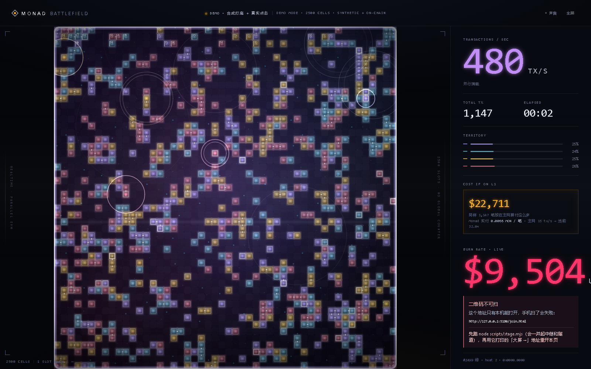
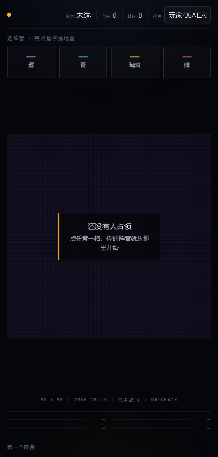
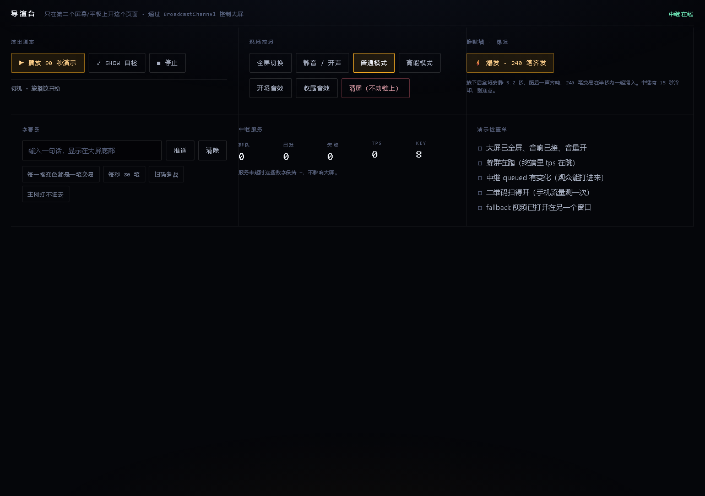

# MONAD BATTLEFIELD

> **Live public demo:** https://monabattlefield.pages.dev/  ·   https://naiwaniubi.github.io/monad-battlefield/ (static, honest DEMO density build). Full wall page: `.../full.html`. The interactive venue build (audience QR + sync receipts) is served through a cloudflared tunnel at the event — see docs/RUNBOOK.md.

**2,500 independent cells. Parallel payer lanes. Every claim is one on-chain transaction — and one note of sound.**

The one-line technical claim:

> We did not write a single line of parallel code. We partitioned the state into 2,500 cells that share nothing, and let the EVM run them in parallel.



<sub>Density layer (demo): this shot runs `?demo=1` — the top bar itself reads `DEMO · 合成打底 + 真实点击` and the 84 tx/s on screen is the synthetic layer (`DEMO_RATE = 80/s`) over real audience taps. The measured **real on-chain** peak was **16 tx/s** across 17 funded lanes (see table below). Each square is one storage slot that only its own claim writes to. The QR is live — it decodes to the audience page on whatever network the room is on.</sub>

| Audience page | Stage control |
|---|---|
|  |  |
| No wallet, no gas, no seed phrase. Shown here in its empty state — the first person to scan is told what to do, which matters when nobody has claimed yet. | Drives the main screen over the relay, so it works from a tablet — not just another window on the same laptop. |

---

## Why this needs Monad specifically

The contract holds a `Cell[2500]` array. Each cell is one 25-byte struct packed into one storage slot:

```solidity
struct Cell { address owner; uint32 heat; uint8 color; }   // 25 bytes → 1 slot
Cell[CELLS] public cells;

function claim(uint16 id, uint8 color) external {
    if (id >= CELLS) revert BadId();
    Cell storage c = cells[id];
    c.owner = msg.sender;
    c.color = color;
    uint32 h; unchecked { h = c.heat + 1; }
    c.heat = h;
    emit Claim(id, msg.sender, color, h);
}
```

Two claims on different cells touch **disjoint storage**. There is no global counter, no shared total, no mutex — the stats you see on screen are all derived off-chain from events. A batch of simultaneous claims therefore has nothing to contend on, which is exactly the workload a parallel EVM is built for. This is not a thought experiment: block **#81474005** on Monad testnet contains **17 `claim` transactions from 17 distinct EOAs** in one ~1-second block, all landed ([docs/EVIDENCE.md](docs/EVIDENCE.md), with a copy-paste `eth_getBlockByNumber` check you can run on stage).

What a global hot counter *would* cost is worth stating precisely, because it is the most-misquoted sentence about parallel EVMs: it would not turn execution into a serial queue. Overlapping write sets make the optimistic parallel executor **re-execute** the conflicting batch, giving back most of the parallel speed-up as a re-execution tax (correctness is unaffected). Our zero-overlap design pays **zero re-execution tax** — throughput scales linearly with the number of lanes.

**The real ceiling is not the chain — it is the number of funded EOAs.** A single externally-owned account's transactions are strictly ordered by nonce, so parallelism is capped by the number of independent payers. That is why the project ships `scripts/keys.ts` and `scripts/fund.ts`: to actually reach 40 lanes you need 40 accounts holding gas. This is the honest constraint, and it is also the interesting one.

**And each lane has its own physical speed limit.** Monad's reserve-balance rule throttles any EOA holding less than 10 MON to **1 tx per 3 blocks ≈ 0.83 tx/s**, regardless of the `GAP_MS` you configure. Lowering the gap changes nothing until every lane is recharged to ≥ 10 MON — a chain property we measured rather than assumed (prediction 0.83 × 17 = 14.2 tx/s; measured peak 16).

---

## Measured vs. target — clearly separated

| Metric | Value | How it was measured |
|---|---|---|
| Claim cost | **60,000 gas** | `eth_getTransactionReceipt`, and a hard floor: `gasLimit` 50,000 → 0/3, 60,000 → 3/3. Monad bills by `gasLimit` (receipts show `gasUsed == gasLimit`), so 60k is the true per-claim charge |
| Gas price accepted | **110 gwei** | Every lane uniformly uses **legacy txs + explicit `gasPrice`** — stable across all our logs. (We did not see type-2 succeed on our viem path; no raw rejection error was archived, so we claim no more than that.) |
| Per-claim cost | **0.0066 MON** | 60,000 × 110 gwei |
| **Measured peak throughput** | **16 tx/s** | `swarm-live.log`: 17 funded lanes × 500 ms. First 30 s: 253 txs accepted by the node, 0 failures (mean 8.4 tx/s); peak second: 16 tx/s — sitting right on the reserve-balance prediction 0.83 × 17 ≈ 14.2 tx/s |
| Claims landed on-chain (session total) | **373** | Swarm window 362 + smoke test 1 + audience `sendRawTransactionSync` 10. Within the swarm window: **359** txs were submitted and accepted by the node; from the 254th onward the lanes ran into reserve throttling and the chain rejected the rest (`fail = 6,421`) |
| Sustained throughput | **80 tx/s — config target, not a measurement** | `BOTS × 1000 / GAP_MS` = 40 lanes × 2 tx/s. It requires **≥ 10 MON in every lane** (~400 MON of balance) to clear the reserve-balance wall; never achieved at our 0.14 MON/lane funding |
| Parallel execution proof | **17 claims / 17 EOAs in one block** | Block #81474005, ~1 s block time — [docs/EVIDENCE.md](docs/EVIDENCE.md), reproducible with one `curl` |
| Revert still bills full gas (vs. #363-style contract cooldown) | **`status=reverted`, `gasUsed == gasLimit` = 60,000, wallet −0.0066 MON** | One deliberate `claim(9999)` → `BadId` tx on testnet — [docs/EVIDENCE.md §5](docs/EVIDENCE.md); server-side cooldown (reject **before** any tx = 0 gas) A/B table: [docs/ab-result.json](docs/ab-result.json) (`node scripts/ab-demo.mjs`) |
| End-to-end audience claim | **verified** | Tx `0x36f2c5ea66d949cccadf936f2c06b5d2e6a976b4f9e50248323c9c7ad3ac8536` — submitted from a phone-shaped client through a public HTTPS tunnel, `status: SUCCESS`, block 79578040, 60,000 gas, `Claim(cell=1873)` |
| **Participation → real payout** | **3 real transfers, 0.02 MON paid out** | `scripts/settle.mjs` aggregates 362 `Claim` events / 21 wallets from blocks #81,472,000–#81,479,200 and pays the top-3 contributors `0.00666…` MON each — three legacy txs, all `status=0x1`, recipient balances verified at the receipt blocks. Mechanism proof, not audience income: all three recipients are our own swarm lanes, disclosed in [docs/EVIDENCE.md §6.6](docs/EVIDENCE.md) (`npm run settle -- --pot 0.02 --top 3`) |

Same workload priced on Ethereum L1 — stated carefully, because "the mainnet can't take this" is a price-and-latency claim, not a physics claim:

```
Sustained target:  80 tx/s × 60,000 gas = 4.8 Mgas/s  vs  L1 ~30 Mgas / 12 s ≈ 2.5 Mgas/s
                                        → ~2× L1's gas capacity: it does not fit, full stop.
Measured peak:     16 tx/s × 60,000 gas = 0.96 Mgas/s  → below the gas wall: blocks could include it.
But the demo window — 80 tx/s × 600 s = 48,000 txs = 2.88e9 gas — priced at our 110 gwei
is ≈ 316.8 ETH (≈ $950k at $3k/ETH): an order-of-magnitude counterfactual at same-unit gas price,
and L1 sustains ~15 tx/s, so 80 tx/s of tap-and-see interactivity (fee-market bidding × ~12 s
inclusion) is impossible as an experience. That is the honest version of the comparison.
```

The on-screen figure recomputes this live from the actual transaction count, not from a hard-coded constant.

A second figure on the rail is the **live burn rate** (`USD/S`): what that TPS would cost per second on L1. A growing total is a number; a number that changes every frame reads as a fire. Both are computed from the same measured constants.

**The gas budget is the binding constraint, and it is knowable in advance.** `node scripts/budget.mjs` reads the relay wallets and answers "how many claims can I actually afford":

| What you want on screen | Transactions | Gas fees |
|---|---|---|
| 78 audience members, one tap each | 78 | 0.51 MON |
| 10 s at the 80 tx/s target | 800 | 5.3 MON |
| 90 s at the 80 tx/s target | 7,200 | 47.5 MON |
| **Silence wall** (240 tx submitted within 0.42 s, landing over the next few blocks) | 240 | ~1.6 MON |

Two walls, two different budgets: the 90-second run above needs **~48 MON of testnet gas for fees**, and the 80 tx/s rate itself needs **≥ 10 MON sitting in each of the 40 lanes (~400 MON of balance)** — money spent and money held are both prerequisites. With less, the honest fallback is a synthetic density layer with real on-chain audience taps on top — and the top bar says which mode is active (`live`, `DEMO+chain`, or `DEMO`), so the claim on stage can match the screen.

---

## Three surfaces, one relay

| Surface | Purpose |
|---|---|
| `index.html` — **main screen** | Projected for the audience. Canvas grid, live TPS, territory shares, QR to join. |
| `join.html` — **audience page** | Anyone opens it from a phone. Pick a faction, tap a cell. No wallet, no gas, no seed phrase. |
| `director.html` — **stage control** | The presenter's second screen: run the 90-second show, push subtitles, mute, hype mode. |
| `server/index.mjs` — **relay** | Turns audience taps into on-chain transactions from a pool of funded wallets. |

### Why the relay has 8 keys, not 1

One EOA's transactions are nonce-ordered. A single relay key would compress 78 people's taps into one queue and destroy the whole point. The relay uses **8 keys in rotation, each with its own nonce queue, and never awaits a receipt** — so audience taps are genuinely concurrent.

### Audience participation without a wallet

The audience never signs anything. They tap a cell; the relay signs and pays. This is a deliberate trade-off: it is custodial, it is rate-limited per client, and the relay wallets are throwaway testnet accounts. For a 90-second live demo where the audience vote decides the winner, asking 78 strangers to install a wallet would lose everyone.

---

## Product-level upgrade (v3): make the audience the proof

The demo was something judges *look at*. v3 makes them *part of the claim* — because this contest is decided by an audience vote, every mechanic below is engineered so that **the person who voted has personally pushed a transaction**.

| Feature | What happens | Why it earns the vote |
|---|---|---|
| **Silence wall** | Director fires `burst` → relay goes quiet for 5.2 s → 240 transactions are all *submitted* inside a 0.42 s spread window (the 0.42 s is the submission schedule, not block inclusion) and land over the following blocks → one chord + a ripple wave across the grid | Silence is the only scarce resource in a loud room. The one second where 2500 cells wake up says more than any architecture slide |
| **Human lanes** | Audience holds a finger down on their phone: 1 tap/second each, in-flight capped at 4 | 78 people holding = 78 real payer lanes stacked on the 40 bot lanes. The top bar can honestly say **real-person %**. A voter who felt their own finger move does not vote elsewhere |
| **Live burn rate** | A `USD/S` figure on the rail that recomputes every frame from actual TPS | The $950k counterfactual stops being a number in a slide and becomes a clock the room is burning |
| **Cells with names** | Every audience member picks a handle (auto-generated, editable); the relay stamps it on the cell they take. Bot swarm claims are anonymous | What you can read on the big screen are all humans. This is the visible evidence of "the audience IS the swarm" |
| **Hot/cold/sleeping land** | Cell brightness decays from last-claim time (linear to 42% over 3 days; unknown age renders bright, never dark) | Turns a fading mosaic into a living map with territory, memory, and a day/night story |

### Protocol additions

```ts
// director → main screen (also drives the relay's own clock)
{ type: "burst"; count?: number }          // default 240; 15 s cooldown server-side
// main screen → chord
audio.stinger("burst")
// /api/claim body: { ..., nick }           // ≤16 chars, stamped on success
// /api/state response tail: tags: [[cellId, "nick"], …]   // newest ≤512
// GridState gains: age (s since last claim) · labelOf (nick|null)
```

The two clocks never wait on each other: the moment the director button is pressed, both sides start counting 5.2 s independently. Drifting tens of milliseconds cannot damage the beat because there is nothing to synchronise — only a shared start instant.

---

## Run it

```bash
npm install
npm run build:contract      # solc-js, no Foundry required
cp .env.example .env        # put a funded testnet PRIVATE_KEY in it

npm run deploy              # writes deployments.json + web/src/deploy.json
npm run keys && npm run fund   # create and fund 40 swarm wallets

node scripts/stage.mjs      # builds, starts a public tunnel + the relay, prints three URLs
npm run swarm               # background load on all funded lanes (40 by config; 17 were live-funded and measured)
```

`stage.mjs` prints exactly three URLs that share one origin — the main screen, the audience page and the director page. Open all three from those printed URLs and nothing else; mixing `localhost` with a LAN address is how the subtitle channel silently breaks.

### Verify before you present

```bash
node scripts/gate.mjs
```

Six checks, all deterministic, all fail loudly:

| # | Check | What it decides |
|---|---|---|
| 0 | `scripts/check-secrets.mjs` | **No private key is tracked by git.** Three key files were caught by this during development — one of them had already been staged for commit. |
| 1 | `tsc --noEmit` | Types. `vite build` does not typecheck; this one cannot be skipped. |
| 2 | `vite build` | All three entry points still build. |
| 3 | `vitest run` | 296 unit tests (18 files) over TPS windowing, dedupe, EMA, grid state, decay curve, burn rate, burst schedule, hold rhythm, HUD, audio and the relay's sync-claim path. |
| 4 | `scripts/qr-check.py` | **Decodes the rendered QR image**, asserts the host is routable from a phone, then HTTP-GETs it. Also injects a relay failure to prove the screen refuses to draw a dead code. |
| 5 | `scripts/director-check.py` | Two independent browser contexts (two devices, no shared `BroadcastChannel`) push a subtitle and assert the main screen **actually shows it**. |

---

## Things that were broken and are now fixed

These are listed because they are the kind of failure that only shows up on stage, in front of judges.

| Failure | Consequence | Fix |
|---|---|---|
| QR encoded `location.origin` | Presenter opens the screen on `localhost` → all 78 phones fail to open it. The audience vote is the scoring mechanism. | The QR now asks the relay for `joinUrl`. If the resolved address is loopback, **no QR is drawn** — an actionable warning card appears instead. |
| Relay picked "first non-internal IPv4" | On the dev machine that was a Tailscale CGNAT address (`100.94.x`) — routable by nobody in the room. | Physical NICs rank first; Tailscale / VMware / WSL / Hyper-V / Docker rank last; link-local `169.254.x` excluded. |
| `.env` pinned `JOIN_URL` to `localhost:5180` | Silently overrode every one of the fixes above. | Removed, and the relay now **refuses** a loopback `JOIN_URL` with a warning instead of trusting a provably wrong config. |
| Director used `BroadcastChannel` only | It does not cross devices — and the page's own copy tells you to open it on a tablet. `postMessage` does not throw, so the status bar said "sent" while nothing happened. | Second channel: `POST /api/director`, polled by the main screen. The status bar now names which channel delivered. |
| Audience page only counted its own taps | Tapping once showed "my faction 100% of territory" while the big screen showed four continents. Refreshing lost the cell but kept the count. | Relay maintains a global grid cache at `/api/state`; all three surfaces read the same truth. |
| Per-claim additive glow + 8-cell shockwave rings | At density-layer rates (the synthetic 80 tx/s stream) the screen was a flickering mosaic — the territory story was invisible under the noise. | Flash is now a thin rim; shockwaves are rationed to a fixed 8/s regardless of load. |
| `TOTAL` next to a bare `92` | A judge sees a number with no visible unit — the label was 9.5px against a 104px figure. | Unit is `TX/S` at 21px, baseline-aligned with the number. |
| Relay death was silent on the main screen | Audience taps stopped working; the screen the presenter watches showed nothing. | "relay unreachable · taps will not go on-chain" banner after 2 consecutive failures. |
| `?demo=1` ignored the chain entirely | Audience taps really did go on-chain, phones showed success, and the big screen showed none of it. | Demo mode now layers the synthetic stream **on top of** real chain events. |

---

## What is verified, and what is not

**Verified**
- The full audience path: public HTTPS tunnel → relay → signed legacy tx → block → `Claim` event, with a transaction hash and receipt.
- The QR image is decoded (not assumed) and its target is fetched over HTTP.
- Cross-device stage control, using two browser contexts that share nothing.
- Unit-tested pure logic: TPS sliding window, event dedupe, EMA, grid state transitions — and the v3 additions `decayFactor`, `burnRatePerSecond`, `burstSchedule`, `shouldFireHold` (296 tests total, per `vitest run`).

**Not verified**
- Touch ergonomics and safe-area insets on real phones. Everything was judged on desktop Chromium at phone viewport sizes.
- Readability on an actual projector under venue lighting. Contrast was computed against WCAG (the smallest label tokens were raised from 2.09:1 to 3.00:1), but that is arithmetic, not a photograph of a wall.
- The public RPC only serves `eth_getLogs` over roughly the last 100 blocks, so `/api/state` cannot reconstruct deep history. The API reports `complete: false` rather than pretending otherwise, and every claim the relay itself submits is written into the cache immediately, so live participation is never lost. (Push itself is available: the official `wss` endpoint's `eth_subscribe` was tested working; the gap is the historical log window, not notifications.)

---

## Repository layout

```
contracts/Battlefield.sol    2500 cells, one slot each, no global counter
scripts/build.ts             solc-js compile (no Foundry needed)
scripts/deploy.ts            deploy + write deployments.json
scripts/keys.ts / fund.ts    create and fund the payer lanes
scripts/swarm.ts             per-lane concurrent load generator (BOTS lanes, one funded wallet each)
scripts/gate.mjs             one-command acceptance gate (6 checks)
scripts/stage.mjs            build + tunnel + relay, prints the three URLs
scripts/qr-check.py          decodes the QR and fetches its target
scripts/director-check.py    two-device stage-control check
server/index.mjs             relay: key pool, per-key nonce queues, grid cache
web/                         Vite + Canvas: main screen, audience page, director
tests/                       296unit tests
docs/RUNBOOK.md              on-site operations manual (Chinese)
```

---

## Contract

```
network   Monad Testnet (chainId 10143)
address   0xd525ef7ee4072e80765fd61633d80322040afd9d
block     79333331
bytecode  707 B creation (solc-js build output) / 676 B deployed runtime
```

## Secrets

`.env`, `.relayers.json` and `.bots.json` hold private keys and are git-ignored. Everything in this repository assumes **testnet-only** wallets. If you fork this, use accounts you are willing to burn.
